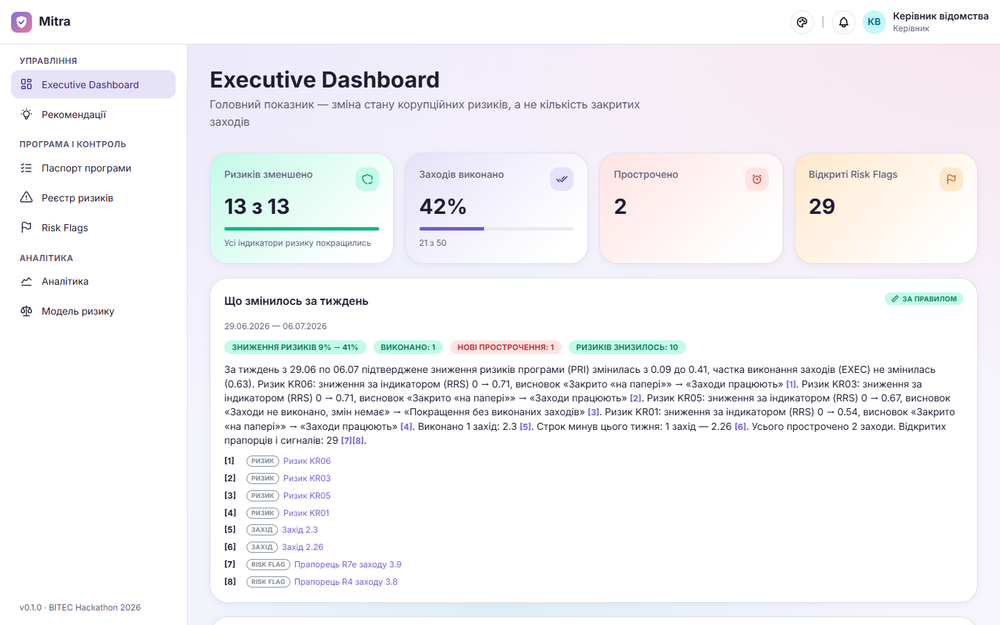
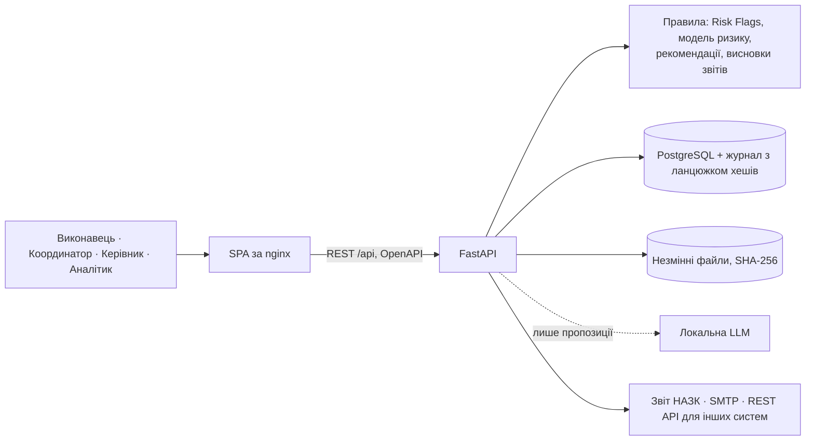

# Mitra — моніторинг виконання антикорупційної програми

Команда «FOXHOUND» · Завдання 2. Цифрова система моніторингу виконання антикорупційної програми (Digital Anti-Corruption Monitor)

## Проблема і користувач

Користувачі Mitra — уповноважена особа з питань запобігання та виявлення корупції, яка координує програму органу сектору безпеки і оборони, виконавці заходів у структурних підрозділах і керівник органу. Сьогодні програма живе в наказі, звіти надходять листами й таблицями, строки контролюються вручну, а звіт за півріччя на Портал доброчесності НАЗК щоразу зводиться заново. Через це багато часу йде на рутину: збирання, нагадування, перенесення даних. Головне при цьому залишається невидимим: звітність фіксує, що захід виконано, але не показує, **чи зменшився корупційний ризик**, на який він спрямований. Mitra бере на себе рутину і переводить увагу з кількості закритих заходів на зміну стану ризиків.

## Що робить рішення

- **Електронний паспорт програми:** три розділи, як на Порталі НАЗК; заходи розділу 2 повʼязано з корупційним ризиком, а ризик — з індикатором (KRI) з базою, ціллю і лагом ефекту.
- **Кабінет виконавця і внесення за один крок:** лише власні заходи, підказка, які документи потрібні, незмінні підтвердні матеріали з SHA-256. Звіт можна просто перетягнути документом.
- **Risk Flags за явними правилами:** прострочення, відсутність доказів, формальне закриття (виконано, а індикатор ризику не змінився), неінформативний опис, невиконання показника, повторні порушення строків, документи «заднім числом». Кожен прапорець має факти і пояснення.
- **Модель ризику «виконання × ефект»:** для кожного ризику — висновок «заходи працюють», «закрито на папері», «погіршення попри виконання» тощо, плюс розрив формального виконання (FCG).
- **Панелі для кожної ролі** та **рекомендації** з підставою. Рішення ухвалює керівник, призначаючи відповідального і строк.
- **Звіт за півріччя у структурі полів Порталу доброчесності НАЗК** (JSON, CSV, DOCX, PDF, XLSX, друкована форма) і **аналітична довідка**. Звіт підписано HMAC, справжність перевіряється за QR.
- **Журнал дій з ланцюжком хешів:** хто, коли і що змінив; цілісність журналу можна перевірити.



## Демонстрація

- Відео (до 3 хвилин): **TODO: посилання на відео**
- Робоча версія: https://mitra.csit-mitit.com (на сторінці входу можна обрати демо-акаунт будь-якої ролі)
- Сценарій повного циклу, панелі ролей і приклади звітів: [docs/demo.md](docs/demo.md)

## Як запустити

Потрібно встановити: **Docker** з Docker Compose v2, **Git** і **Python 3** (лише для генерації секретів).

```bash
# 1. Клонувати репозиторій
git clone https://github.com/fxhxyz4/Mitra.git && cd Mitra

# 2. Створити файл налаштувань
cp .env.example .env

# 3. Згенерувати секрети і вимкнути зовнішній LLM-сервер з прикладу
for k in POSTGRES_PASSWORD SESSION_SECRET REPORT_SECRET DEMO_TOKEN_SECRET; do
  sed -i "s|^$k=.*|$k=$(python3 -c 'import secrets;print(secrets.token_urlsafe(32))')|" .env
done
sed -i 's|^LLM_BASE_URL=.*|LLM_BASE_URL=|' .env

# 4. Запустити: без ШІ (швидко) або з локальною моделлю (перший запуск завантажує ~5 ГБ)
docker compose up --build -d
# docker compose --profile ollama up --build -d

# 5. Відкрити http://localhost і обрати демо-акаунт на сторінці входу
```

Під час першого старту база заповнюється синтетичним набором організаторів: 14 підрозділів, 50 заходів, 14 корупційних ризиків, звіти за І півріччя 2026. Демо-акаунти: `coord` (координатор), `head` (керівник), `ex-p08` (виконавець), `analyst`, `admin`. Без ШІ система працює повністю: усі висновки дають правила. Запуск без Docker описано в [CONTRIBUTING.md](CONTRIBUTING.md) і [backend/README.md](backend/README.md).

## Як влаштовано

**Стек:** React 19, Vite, TypeScript, Mantine, TanStack Query, Recharts → nginx → FastAPI, SQLAlchemy 2 → PostgreSQL 16. Сховище файлів — write-once. Локальна модель через Ollama (`gemma3:4b`, `bge-m3`) або будь-який OpenAI-сумісний сервер у закритому контурі.



**Де основна логіка:** `backend/app/services/`:
- `control.py` — Risk Flags, рекомендації, нагадування;
- `risk_model.py` — модель ризику;
- `measures.py` — життєвий цикл заходу;
- `reports.py` і `integrity.py` — звіти та їх підпис;
- `dashboards.py` — панелі;
- `intake.py` — розбір документів;
- `backend/app/audit.py` — журнал дій.

Фронтенд лежить у `frontend/src/`. Детальніше — у [docs/architecture.md](docs/architecture.md).

**Які правила ухвалюють висновки** (пункт 4 Політики використання ШІ). Усі висновки з наслідками система робить за явними правилами з порогами в коді. Користувач бачить код правила, дані і пояснення:

| Висновок | Правило | Де |
|---|---|---|
| Risk Flags | **R1** строк минув, результат не подано · **E1** «виконано» без документа · **F1** захід розділу 2 виконано, а індикатор ризику пройшов < 10 % шляху до цілі · **F2** ризик погіршився (RRS < 0) · **R4** опис схожий на назву (≥ 75 %) або без числа чи посилання · **R5** індикатор виконання нижче цілі · **R6** у підрозділу ≥ 2 прострочені заходи · **R6a** строк переносили ≥ 2 разів · **R7a, R7b, R7c, R7e** дати поза періодом, документи «заднім числом», «Не виконано» без пояснення, опис до настання строку | `services/control.py`, `services/rules.py` |
| Вердикт ризику | матриця «є виконані заходи» × «стан індикатора» (на траєкторії / без змін / погіршення / немає даних); RRS — зважений прогрес індикаторів від бази до цілі. Позитивний прогрес за самозвітними даними враховується × 0,5, зміни в межах шуму не вважаються рухом | `services/risk_model.py`, [docs/risk-model.md](docs/risk-model.md) |
| Рівень ризику невиконання заходу | **високий:** строк минув, або захід повернено і до строку ≤ 14 днів, або до строку ≤ 14 днів без проміжних результатів · **середній:** до строку ≤ 30 днів або є відкриті прапорці | `services/dashboards.py` |
| Висновки аналітичної довідки | **I1–I7:** частки виконання; прострочення (критично від 25 %); зменшення ризиків і формальне закриття; виконані без доказів; повернення ≥ 30 %; перевірка > 10 днів; підрозділи з ≥ 2 простроченнями (за абеткою, без рейтингу) | `services/reports.py` |
| Рекомендації | шаблон дії для кожного типу прапорця, пріоритет за рівнем ризику; **рішення ухвалює керівник**, призначаючи відповідального і строк | `services/control.py` |

Мовна модель **лише пропонує**: чернетку форми з документа (тільки з переданих кандидатів), чіткіший опис результату (без нових чисел), переказ стану ризику з посиланнями на джерела, формулювання рекомендації. Людина приймає або відхиляє пропозицію, і це записується в журнал. Модель не ставить прапорці, не змінює статуси, бал ризику і звіти.

## Документація

| Файл | Що в ньому |
|---|---|
| [docs/architecture.md](docs/architecture.md) | компоненти, модулі і де вони в коді, ролі та безпека, розгортання в закритому контурі і як модуля |
| [docs/risk-model.md](docs/risk-model.md) | як рахується ризик: прогрес індикатора ризику, RRS, вердикт «виконання × ефект», підстави для переоцінки, PRI / EXEC / FCG, з прикладами |
| [docs/demo.md](docs/demo.md) | повний цикл роботи із заходом від планування до звіту, панелі виконавця, координатора і керівника, приклади звіту й довідки |
| [docs/examples/](docs/examples/) | звіт НАЗК (PDF, DOCX, XLSX, JSON, CSV) і аналітична довідка (PDF, DOCX), сформовані системою |
| [docs/time-savings.md](docs/time-savings.md) | розрахунок економії часу виконавця, координатора і уповноваженої особи за півріччя |
| [docs/integration.md](docs/integration.md) | карта інтеграції: які системи дають і отримують дані, що вже реалізовано, а також бачення інтеграції з ІС МОУ та НАЗК |
| [docs/safeguards.md](docs/safeguards.md) | можливі зловживання системою і її показниками, запобіжники з місцем у коді |
| [docs/ai.md](docs/ai.md) | записка «Як ми використали ШІ» |
| [Дошка Miro «Mitra»](https://miro.com/app/board/uXjVEN5x-0Y=/?share_link_id=750867613024) | схеми системи (архітектура, життєвий цикл заходу, Risk Flags, звіт НАЗК, доменна модель, схема БД, REST API, роутинг, дашборди) і модель ризику з формулами; відкривається без входу, лише для перегляду |
| [docs/zrazky/](docs/zrazky/README.md) | зразки документів, які система приймає файлом (звіт виконавця, картка заходу) |

## Що використали

- **Дані:** синтетичний набір організаторів Завдання 2 (`backend/app/datasets/zavdannia-2/`). Реальних, персональних і службових даних у проєкті немає.
- **Моделі ШІ (локально, через Ollama):** [Gemma 3 4B](https://ollama.com/library/gemma3) (Google, Gemma Terms of Use), ембединги [BGE-M3](https://ollama.com/library/bge-m3) (BAAI, MIT).
- **Бекенд:** FastAPI, Starlette, Uvicorn, Pydantic, pydantic-settings, SQLAlchemy, psycopg, httpx, python-multipart, openpyxl, python-docx, fpdf2, pypdf, segno (QR), tzdata; тести — pytest.
- **Фронтенд:** React, React Router, Vite, TypeScript, Mantine (core, dates, charts, dropzone, notifications), TanStack Query, Recharts, dayjs, Tabler Icons, шрифти Inter і Unbounded (Fontsource); Vitest, Testing Library, ESLint, Prettier, Husky, commitlint.
- **Інфраструктура:** Docker, PostgreSQL, nginx, Ollama.
- **Шрифти у звітах:** DejaVu Serif (`backend/app/fonts/LICENSE-DejaVu.txt`).
- **Інструменти розробки:** Claude Code — див. [docs/ai.md](docs/ai.md).
- **Методична основа:** структура звіту Порталу доброчесності НАЗК і Методологія оцінювання корупційних ризиків НАЗК (бал ймовірність × наслідки).

Ліцензія — [MIT](LICENSE).
