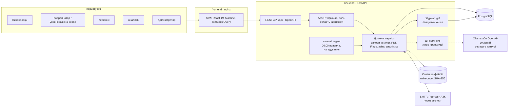
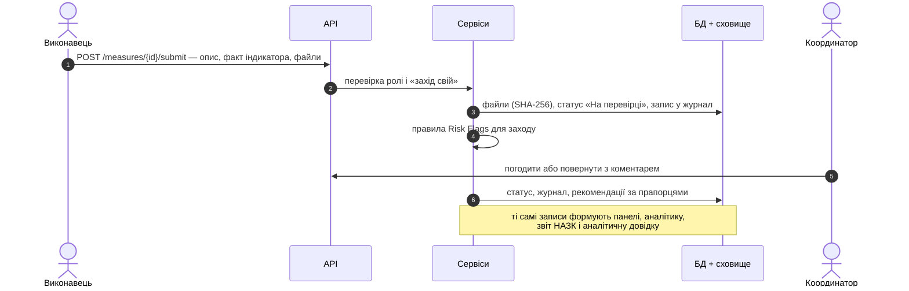

# Архітектура рішення

Mitra — вебзастосунок з трьох контейнерів: фронтенд (SPA за nginx), бекенд (FastAPI) і PostgreSQL. Четвертий контейнер з локальною мовною моделлю (Ollama) необовʼязковий. Усі компоненти працюють у закритому відомчому контурі, зовнішні хмарні сервіси не потрібні.

## Компоненти

| Компонент | Технології | Де в коді |
|---|---|---|
| Фронтенд | React 19, Vite, TypeScript, Mantine 9, TanStack Query, Recharts; у продакшні nginx віддає статику і проксує `/api/` на бекенд | `frontend/src/`, `frontend/docker/nginx.conf` |
| REST API | FastAPI, Pydantic; OpenAPI на `/api/openapi.json`, Swagger на `/api/docs` | `backend/app/routers/` |
| Доменна логіка | SQLAlchemy 2; уся логіка в сервісах, роутери лише перевіряють права і викликають сервіс | `backend/app/services/` |
| База даних | PostgreSQL 16 (у Docker); SQLite для локальної розробки й тестів | `backend/app/models.py`, `backend/app/db.py` |
| Сховище підтвердних матеріалів | файли пишуться один раз, видалення через API немає, SHA-256 перевіряється при завантаженні | `backend/app/services/storage.py` |
| Журнал дій | кожен запис містить старе і нове значення та хеш попереднього запису; перевірка ланцюжка `GET /api/audit/verify` | `backend/app/audit.py` |
| Фонові задачі | щоденний запуск правил о 06:00, нагадування за 7/3/1 день, доставка e-mail; lease у БД, тож при кількох репліках задачу виконує одна | `backend/app/main.py`, `backend/app/services/leases.py` |
| ШІ-помічник | локальна модель через Ollama (`gemma3:4b`, ембединги `bge-m3`) або будь-який OpenAI-сумісний сервер у контурі (`LLM_BASE_URL`); `temperature=0`, фіксований `seed`, кеш відповідей | `backend/app/llm.py`, `backend/app/services/assistant.py` |

## Модулі завдання і де вони реалізовані

| Модуль із завдання | Сервіс | Що робить |
|---|---|---|
| Program Register | `services/measures.py`, `routers/programs.py` | електронний паспорт: 3 розділи → заходи, строки, відповідальні, звʼязок «захід → ризик → індикатор» |
| Реєстр ризиків і модель ризику | `services/risk_model.py`, `routers/risks.py` | ризики з балом L×C, індикатори (KRI) з базою, ціллю і лагом ефекту; вердикт «виконання × ефект» |
| Activity Management, Evidence Tracker | `services/measures.py`, `services/storage.py` | внесення за один крок, погодження і повернення, незмінні файли з SHA-256 |
| Deadline Control | `services/control.py`, `services/dashboards.py` | календар строків, нагадування, рівень ризику невиконання |
| Risk Flags | `services/control.py`, `services/rules.py` | явні правила R1–R7e, F1/F2, E1 з фактами і поясненням |
| Рекомендації | `services/control.py` | рекомендація за кожним відкритим прапорцем; рішення ухвалює керівник, призначаючи відповідального і строк |
| Executive Dashboard, Performance Monitoring | `services/dashboards.py`, `services/performance.py`, `services/analytics.py` | панелі за ролями, карта підрозділів без рейтингу, тренди |
| Reporting Engine | `services/reports.py`, `services/exporters.py`, `services/integrity.py` | звіт за півріччя у структурі Порталу НАЗК, друкована форма, аналітична довідка; JSON/CSV/DOCX/PDF/XLSX; HMAC-підпис і QR для перевірки |
| Audit Trail | `app/audit.py`, `routers/audit.py` | журнал дій з ланцюжком хешів |
| Кабінет виконавця | `services/dashboards.py`, `routers/measures.py` | лише власні заходи, внесення за один крок, підказка, які документи потрібні |
| Внесення документом | `services/intake.py`, `services/documents.py`, `services/templates.py` | розбір DOCX/XLSX/PDF/TXT за зразками A/B (`docs/zrazky/`) у чернетку форми |
| Інтеграції | `services/importer.py`, `services/notify.py` | імпорт даних органу з JSON, нагадування через SMTP |

## Ролі і доступ

Ролі: `EXECUTOR`, `COORDINATOR`, `HEAD`, `ANALYST`, `ADMIN`. Права описано в `backend/app/auth.py`, область видимості — у `backend/app/services/scope.py`:

- виконавець бачить лише заходи, призначені йому особисто або його підрозділу (якщо виконавця в призначенні не вказано);
- керівник підрозділу бачить свій підрозділ і підпорядковані, керівник органу — усе;
- адміністратор веде облікові записи, але не має доступу до предметних даних; надання ролі `ADMIN` вимагає окремого пароля (`ADMIN_GRANT_HASH`).

Вхід: персональний токен (у БД лише його sha256) обмінюється на сеанс у cookie `HttpOnly`, `SameSite=Strict`. Запити, що змінюють дані, потребують заголовка `X-Requested-With` (захист від CSRF). Інтеграції працюють через `Authorization: Bearer`.

## Потік даних: «внесли один раз — використали скрізь»

## Розгортання

- **Docker Compose** (`docker-compose.yml`): `postgres`, `backend`, `frontend`, а також `ollama` в окремому профілі. GPU вмикається через `docker-compose.gpu.yml`.
- **Закритий контур:** модель працює локально. Для більших моделей можна вказати OpenAI-сумісний сервер усередині мережі відомства (`LLM_BASE_URL`). Якщо ШІ вимкнути (`AI_ENABLED=false` або вмикач адміністратора), система працює повністю: усі висновки дають правила.
- **Модуль наявної системи:** увесь функціонал доступний через REST API з OpenAPI-контрактом. Фронтенд — лише один зі споживачів. Точки підключення SSO, оргструктури, СЕД, обʼєктного сховища і Порталу НАЗК описано в [integration.md](integration.md).
- **Масштабування на інші органи:** дані органу завантажуються імпортом (`POST /api/admin/import`, формат — `data/sample-import.json`). Бекенд не зберігає стан між запитами, фонові задачі розподіляються через lease, тому його можна запускати в кількох репліках.
