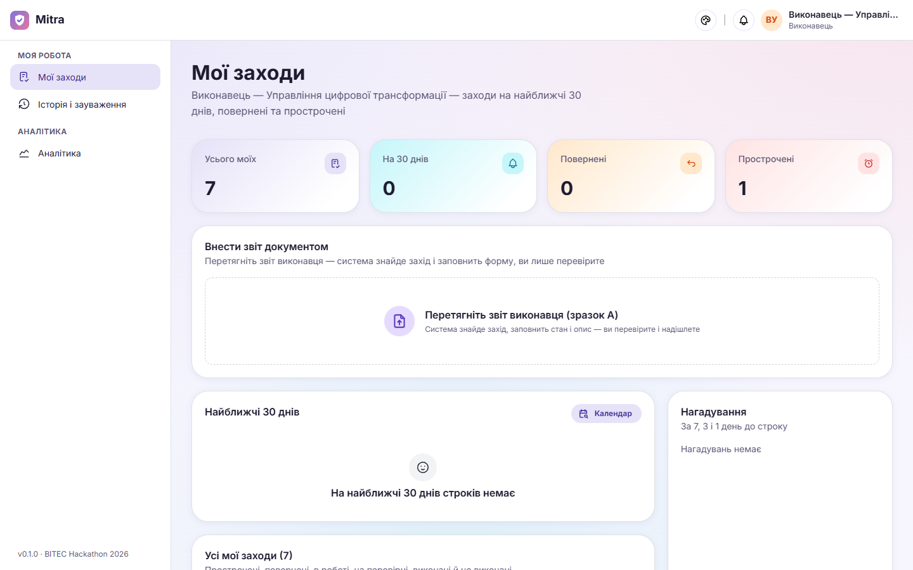
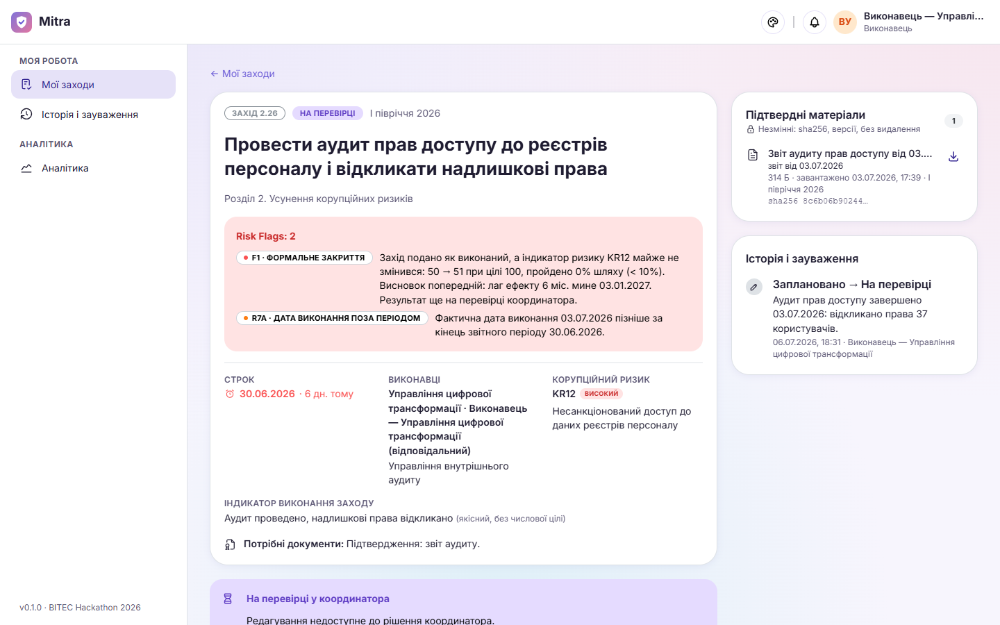
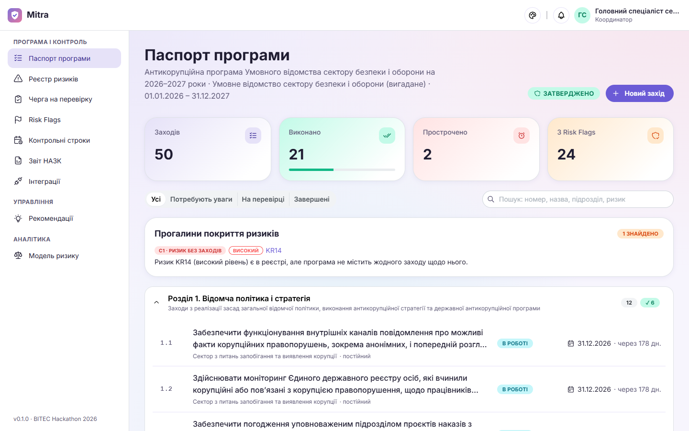
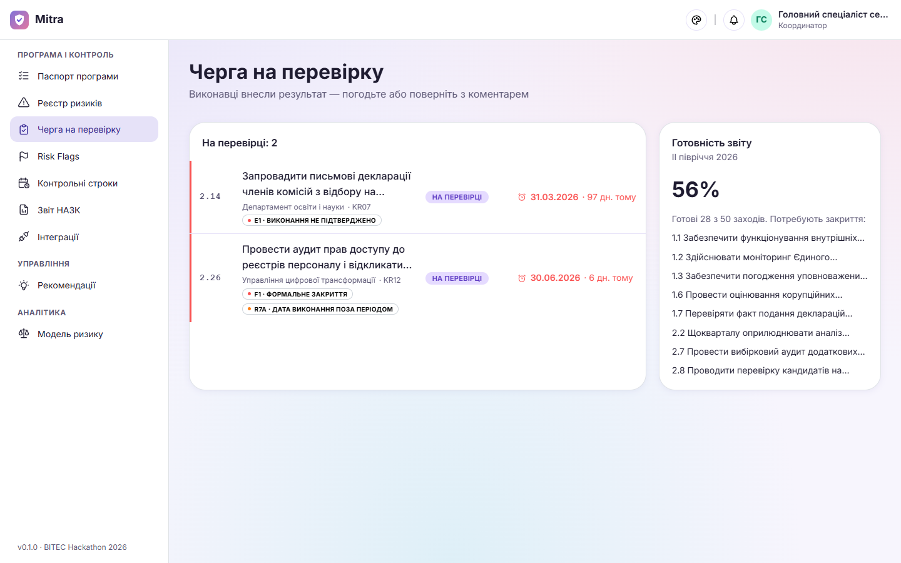
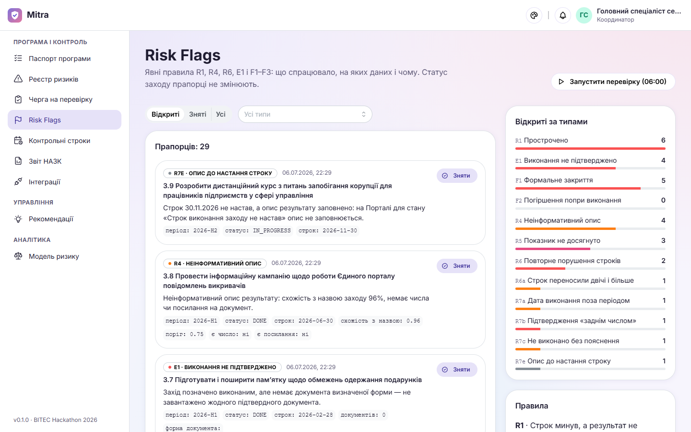
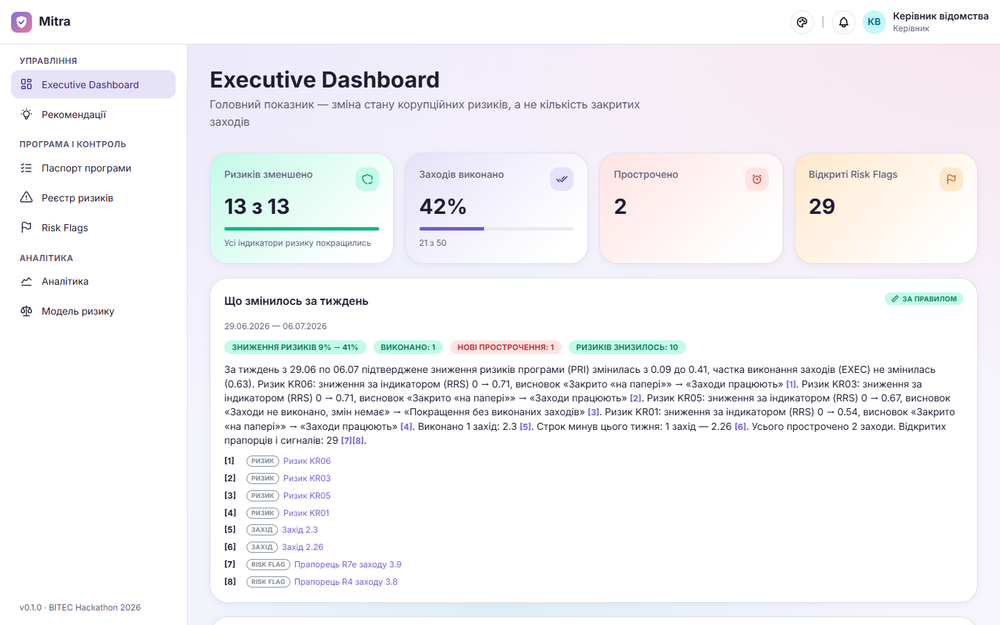
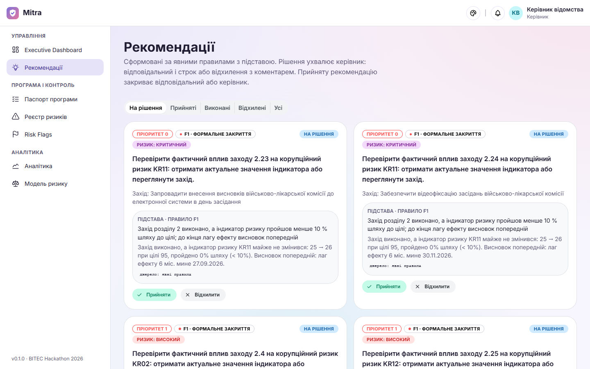
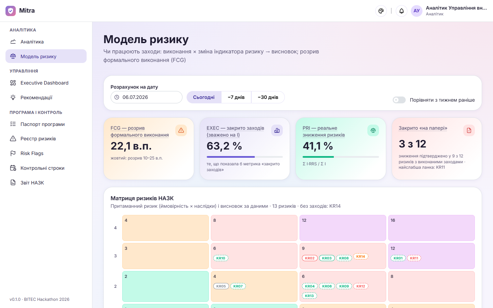
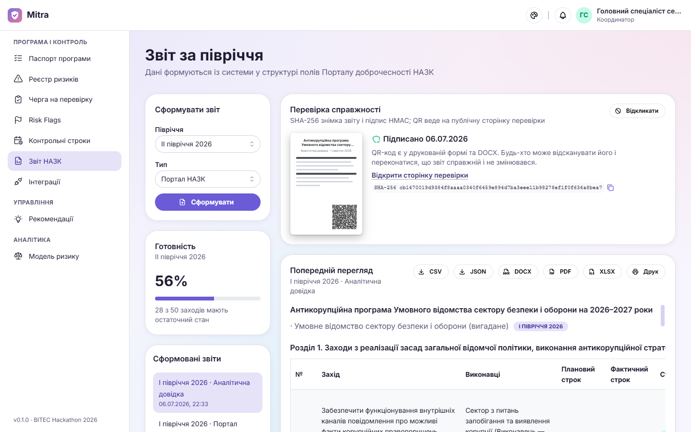

# Демонстрація: повний цикл, панелі, звіти

Усі дані синтетичні: це набір організаторів Завдання 2 (`backend/app/datasets/zavdannia-2/`) про вигадане «Умовне відомство сектору безпеки і оборони». Стан на 06.07.2026, звітний період — І півріччя 2026. Скриншоти й файли нижче отримано з робочої системи на цьому наборі.

Вхід: з `DEMO_LOGIN=true` сторінка входу показує демо-акаунти кнопками. Акаунти, які знадобляться:

| Акаунт | Роль |
|---|---|
| `coord` | Координатор (головний спеціаліст сектору з питань запобігання та виявлення корупції) |
| `ex-p08` | Виконавець (Управління цифрової трансформації) |
| `head` | Керівник відомства |
| `analyst` | Аналітик Управління внутрішнього аудиту |

## 1. Повний цикл роботи із заходом

| Крок | Хто | Де в інтерфейсі | Що відбувається в системі |
|---|---|---|---|
| 1. Планування | `coord` | «Паспорт програми» → «Новий захід» або перетягнути картку заходу (зразок B з [zrazky/](zrazky/README.md)) | Захід потрапляє в один із трьох розділів. Координатор вказує строк, відповідальний підрозділ і співвиконавців, корупційний ризик (обовʼязковий для розділу 2), індикатор і потрібні документи. Блок «Прогалини покриття» показує ризики без заходів (C1) |
| 2. Звʼязок з ризиком | `coord` | «Реєстр ризиків» | Ризик має бал L×C і індикатор (KRI) з базою, ціллю і лагом ефекту. Під час затвердження програми база фіксується |
| 3. Нагадування | система | дзвіночок, кабінет виконавця | Нагадування за 7, 3 і 1 день до строку: у застосунку, а також на e-mail, якщо налаштовано SMTP |
| 4. Внесення за один крок | `ex-p08` | «Мої заходи» → картка заходу | Одна форма: «Виконано / Не виконано», опис, факт індикатора, файли з типом і датою. Підказка показує, яких документів бракує. Можна перетягнути звіт за зразком A: система сама знайде захід і заповнить форму. Файли отримують SHA-256 і стають незмінними, статус — «На перевірці» |
| 5. Автоматичний контроль | система | «Risk Flags» | Правила перевіряються після кожної зміни і щодня о 06:00. На прикладі заходу 2.26: **F1** — індикатор ризику KR12 майже не змінився (50 → 51 при цілі 100), **R7a** — дата виконання поза періодом |
| 6. Перевірка | `coord` | «Черга на перевірку» → захід | Координатор погоджує або повертає захід з обовʼязковим коментарем. Повернений захід зʼявляється у виконавця в «Повернених» |
| 7. Управлінське рішення | `head` | «Рекомендації» | За кожним відкритим прапорцем є рекомендація з підставою (правило, факти). Керівник приймає її, призначаючи відповідального і строк, або відхиляє з коментарем. F1 і F2 знімає лише керівник |
| 8. Звітність | `coord` | «Звіт НАЗК» → півріччя → «Сформувати» | Звіт у структурі полів Порталу і аналітична довідка формуються з уже внесених даних. Експорт: CSV, JSON, DOCX, PDF, XLSX, друк. Звіт підписується HMAC, а QR веде на публічну сторінку перевірки |
| 9. Простежуваність | будь-хто з правами | «Історія і зауваження», журнал дій | Кожна дія записується в журнал зі старим і новим значенням. Цілісність ланцюжка хешів перевіряє `GET /api/audit/verify` |

## 2. Інформаційні панелі

Усі панелі будуються з тих самих записів, які вносить виконавець. Окремо нічого не заповнюється.

### Виконавець — «Мої заходи»
Лише власні заходи: найближчі 30 днів, повернені із зауваженнями, прострочені, нагадування. Звіт можна внести документом.

Картка заходу: прапорці з поясненням, строк, виконавці, ризик, індикатор, потрібні документи, незмінні підтвердні матеріали з SHA-256, історія.

### Координатор програми
Паспорт програми: три розділи, KPI, прогалини покриття ризиків.

Черга на перевірку і готовність звіту за півріччя:

Risk Flags: що спрацювало, на яких даних і чому, а також розподіл за правилами.

### Керівник — Executive Dashboard
Головний показник — скільки ризиків зменшено за індикаторами, а не скільки заходів закрито. Під ним — зведення «Що змінилось за тиждень», побудоване за правилами, з посиланнями на джерела.

Рекомендації на рішення: пріоритет, правило-підстава і факти, кнопки «Прийняти» і «Відхилити».

### Аналітик — модель ризику
Розрив формального виконання (FCG), частка закритих заходів (EXEC) проти реального зниження ризиків (PRI), матриця ризиків НАЗК з висновком за даними.

## 3. Автоматично сформовані звіт і аналітична довідка

Файли сформовано системою за І півріччя 2026 (`POST /api/reports/generate`, потім експорт):

| Документ | Файли | Що всередині |
|---|---|---|
| Звіт про виконання антикорупційної програми (структура Порталу доброчесності НАЗК) | [PDF](examples/zvit-nazk-2026-H1.pdf) · [DOCX](examples/zvit-nazk-2026-H1.docx) · [XLSX](examples/zvit-nazk-2026-H1.xlsx) · [JSON](examples/zvit-nazk-2026-H1.json) · [CSV](examples/zvit-nazk-2026-H1.csv) | три розділи. По кожному заходу: виконавці, строк, «Фактичний строк виконання» (для постійних заходів — кінець півріччя), «Стан виконання», «Опис результату виконання заходу або пояснення причин невиконання» |
| Аналітична довідка для керівництва | [PDF](examples/analitychna-dovidka-2026-H1.pdf) · [DOCX](examples/analitychna-dovidka-2026-H1.docx) | висновки за правилами I1–I7 з позначкою правила, основні показники, стан корупційних ризиків «база → ціль → поточне», ознаки формального закриття, рекомендації |

Приклад висновків із довідки:

> • Виконано 31 з 50 заходів (62.0%), на перевірці — 2, повернено на доопрацювання — 0, не виконано — 6. [правило I1]
> • Критично: За індикаторами зменшено 13 з 13 корупційних ризиків. Ознаки формального закриття (заходи виконано, індикатор не змінився): KR02, KR11, KR12. [правило I3]
> • Увага: Підтвердні матеріали є лише для 90.3% виконаних заходів. [правило I4]
