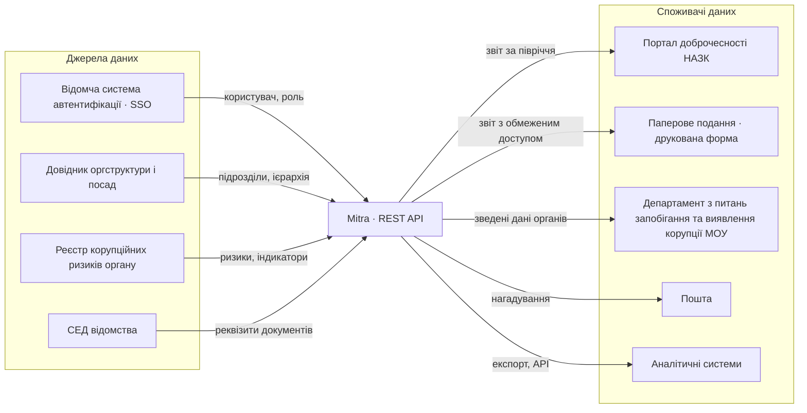
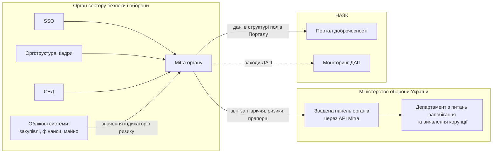

# Карта інтеграції

Рішення спроєктоване як **модуль (сервіс)**, який підключається до наявних інформаційних систем через REST API, а не як окрема ізольована система. Нижче описано, які системи можуть бути джерелами і споживачами даних, що саме передається і яку точку розширення вже передбачено в коді.

Статус: ✅ реалізовано в прототипі · 🔌 точку розширення передбачено, потрібен адаптер · 📋 бачення.

## Загальна схема

## Вхідні інтеграції

| Система | Які дані отримуємо | Як | Статус |
|---|---|---|---|
| Відомча система автентифікації (SSO, OIDC) | особа, роль, підрозділ | заміна `auth.current_user`: перевірка JWT замість персонального токена; мапінг груп SSO на ролі `EXECUTOR` / `COORDINATOR` / `HEAD` / `ANALYST` / `ADMIN` | 🔌 зараз — персональні токени ✅ |
| Довідник оргструктури | підрозділи та їх ієрархія | `orgUnits` у файлі імпорту (`parent` за назвою) або `POST /api/admin/org-units` | ✅ імпорт і ручне ведення · 🔌 регулярна синхронізація |
| Реєстр корупційних ризиків органу | ризики, рівень, індикатори з базовими і цільовими значеннями та історією | `risks` у файлі імпорту або `POST /api/risks`, `POST /api/indicators`, `POST /api/indicators/{id}/values` | ✅ імпорт і API · 📋 автоматичне завантаження |
| Затверджена антикорупційна програма (документ / таблиця) | розділи, заходи, строки, виконавці, привʼязка до ризиків | `programs` у файлі імпорту: `POST /api/admin/import?dryRun`, CLI або `IMPORT_FILE` при першому старті; повторний імпорт оновлює записи за природними ключами | ✅ імпорт JSON · 🔌 конвертер з таблиці органу |
| СЕД відомства | реквізити наказів, протоколів, листів як підтвердження | посилання та номер документа в описі результату (правило R4 розпізнає «№», «наказ», «протокол») і файли через `POST /api/measures/{id}/evidence` | ✅ ручне внесення · 📋 вибір документа з СЕД |
| Джерела значень індикаторів (обліку, закупівель, кадрів) | фактичні значення показників | `POST /api/indicators/{id}/values` з `sourceEvidenceId` | ✅ API · 📋 регламентне завантаження |

## Вихідні інтеграції

| Система | Які дані передаємо | Як | Статус |
|---|---|---|---|
| Портал доброчесності НАЗК | звіт за півріччя: три розділи, по кожному заходу «Фактичний строк виконання», «Стан виконання», «Опис результату виконання заходу або пояснення причин невиконання» | `GET /api/reports/{id}/nazk?format=json\|csv` — дані в структурі полів Порталу, уповноважена особа переносить їх без перероблення | ✅ |
| Паперове подання до НАЗК | той самий звіт для програм з інформацією з обмеженим доступом | `GET /api/reports/{id}/print` — друкована форма | ✅ |
| Департамент з питань запобігання та виявлення корупції МОУ | зведений стан програм органів, ризики «до / після», прапорці, аналітична довідка | `GET /api/dashboard/executive`, `GET /api/analytics/overview`, `GET /api/reports/{id}/internal`, DOCX / XLSX через `/api/reports/{id}/export` | ✅ API · 📋 агрегація кількох органів |
| Пошта | нагадування за 7 / 3 / 1 день до строку | `services/notify.py`: e-mail через SMTP-сервер відомства; контакти користувача `PUT /api/auth/me/contacts`, журнал доставки в `GET /api/reminders` | ✅ in-app (веб-інтерфейс), e-mail |
| Аналітичні та звітні системи | заходи, статуси, прапорці, журнал дій, KPI і тренди | REST API з OpenAPI-специфікацією (`/api/openapi.json`); `GET /api/analytics/export?format=xlsx\|csv\|json` | ✅ |
| Документообіг (СЕД, друк) | звіт НАЗК і аналітична довідка як документи | `GET /api/reports/{id}/export?format=docx\|pdf\|xlsx` | ✅ файл · 📋 реєстрація в СЕД |
| Кваліфікований електронний підпис (КЕП) | звіт НАЗК і довідка у PDF / DOCX | зараз — HMAC-підпис знімка, QR і реєстр виданих копій за SHA-256 (`GET /api/reports/copies/check`); у промисловому розгортанні той самий момент генерації накладає КЕП уповноваженої особи через засоби КЕП відомства (PAdES / CAdES), щоб підпис перевірявся і поза системою | 📋 |
| Сховище обʼєктів з Object Lock (S3-сумісне) | підтвердні матеріали | реалізація `storage.put_object / get_object / verify` | 🔌 зараз — локальне write-once сховище ✅ |

## Принципи інтеграції

- **Закритий контур:** усі компоненти, включно з мовною моделлю, розгортаються у відомчій мережі; зовнішні хмарні сервіси не потрібні. Нагадування показуються у веб-інтерфейсі; e-mail вимкнений, доки не налаштовано внутрішній SMTP-сервер відомства. Текст нагадування містить лише назву заходу і строк.
- **Одноразове внесення:** дані, отримані з інших систем або внесені виконавцем, використовуються для дашбордів, внутрішньої звітності і звіту НАЗК без повторного введення.
- **Контракт — OpenAPI:** будь-яка система може працювати з модулем через ту саму специфікацію, що й власний фронтенд.
- **Простежуваність на межі систем:** кожен запис, що надійшов через API, потрапляє в журнал дій із зазначенням користувача або сервісного облікового запису.
- **Мінімум даних:** модуль не потребує персональних даних понад відображуване імʼя, роль і підрозділ.

## Бачення інтеграції з інформаційними системами МОУ та НАЗК

Mitra не замінює наявні системи. Вона додає до них звʼязок «захід → ризик → індикатор» і контроль виконання. Пропонуємо рухатися трьома етапами, кожен з яких дає результат сам по собі.

| Етап | Що інтегруємо | Результат |
|---|---|---|
| **1. Модуль в органі** | SSO, оргструктура, імпорт затвердженої програми й реєстру ризиків, SMTP, СЕД (реквізити документів) | один орган веде програму в Mitra; звіт НАЗК і довідка формуються без ручного зведення |
| **2. Рівень МОУ** | Департамент отримує дані кількох органів через той самий REST API (`/api/dashboard/executive`, `/api/analytics/overview`, `/api/reports/{id}/internal`) у зведеній панелі; значення індикаторів ризику регламентно надходять з облікових систем (`POST /api/indicators/{id}/values`) | Департамент бачить стан програм і ризиків органів без запитів і листування; методологія однакова, бо правила й поля скрізь ті самі |
| **3. Обмін з НАЗК** | за наявності API Порталу доброчесності — автоматична передача звіту в нинішній структурі полів (`/api/reports/{id}/nazk`); КЕП уповноваженої особи на звіті; передача стану заходів Державної антикорупційної програми | уповноважена особа підписує і подає звіт, а не переносить його вручну |

Принципи, що роблять цей план реалістичним:
- **Поля звіту вже збігаються з Порталом.** Змінюється лише спосіб передачі, а не дані.
- **Мінімальні зміни в наявних системах.** Mitra споживає їхні дані через імпорт або API і нічого не вимагає змінювати в них.
- **Закритий контур на кожному етапі.** Обмін іде між системами всередині відомчої мережі, а з НАЗК — лише через офіційний канал подання.

## Кроки впровадження як модуля

1. Підключити SSO відомства (заміна однієї функції автентифікації, мапінг ролей).
2. Перетворити оргструктуру, реєстр ризиків і затверджену програму у формат імпорту (`data/sample-import.json`), перевірити з `dryRun` і завантажити.
3. Налаштувати SMTP-сервер відомства для нагадувань.
4. Підключити обʼєктне сховище з Object Lock.
5. Узгодити з НАЗК формат обміну (зараз — структура полів Порталу у JSON / CSV) і, за наявності API, автоматизувати передачу.
