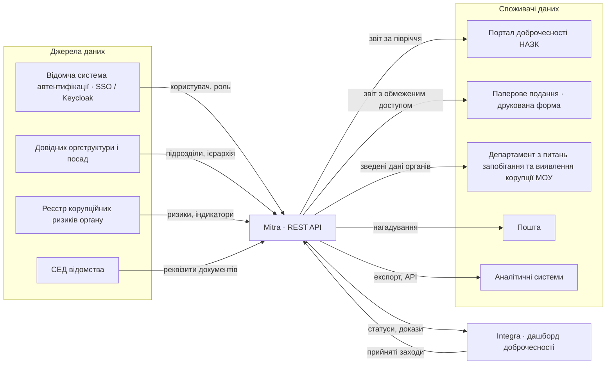
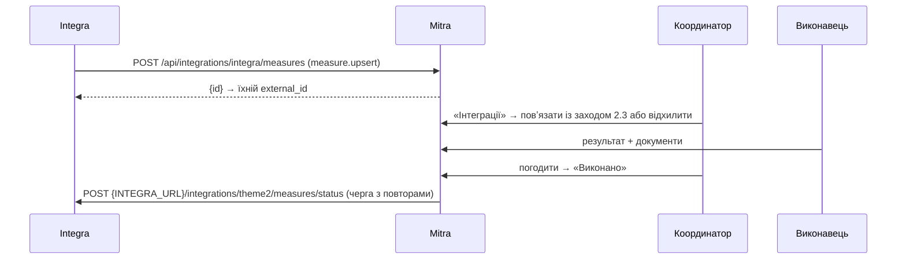

# Карта інтеграції

Рішення спроєктоване як **модуль (сервіс)**, який підключається до наявних інформаційних систем через REST API, а не як окрема ізольована система. Нижче описано, які системи можуть бути джерелами і споживачами даних, що саме передається і яку точку розширення вже передбачено в коді.

Статус: ✅ реалізовано в прототипі · 🔌 точку розширення передбачено, потрібен адаптер · 📋 бачення.

## Загальна схема



## Вхідні інтеграції

| Система | Які дані отримуємо | Як | Статус |
|---|---|---|---|
| Відомча система автентифікації (SSO, Keycloak / OIDC) | особа, роль, підрозділ | заміна `auth.current_user`: перевірка JWT замість персонального токена; мапінг груп SSO на ролі `EXECUTOR` / `COORDINATOR` / `HEAD` / `ANALYST` / `ADMIN` | 🔌 зараз — персональні токени ✅ |
| Довідник оргструктури | підрозділи та їх ієрархія | `orgUnits` у файлі імпорту (`parent` за назвою) або `POST /api/admin/org-units` | ✅ імпорт і ручне ведення · 🔌 регулярна синхронізація |
| Реєстр корупційних ризиків органу | ризики, рівень, індикатори з базовими і цільовими значеннями та історією | `risks` у файлі імпорту або `POST /api/risks`, `POST /api/indicators`, `POST /api/indicators/{id}/values` | ✅ імпорт і API · 📋 автоматичне завантаження |
| Затверджена антикорупційна програма (документ / таблиця) | розділи, заходи, строки, виконавці, привʼязка до ризиків | `programs` у файлі імпорту: `POST /api/admin/import?dryRun`, CLI або `IMPORT_FILE` при першому старті; повторний імпорт оновлює записи за природними ключами | ✅ імпорт JSON · 🔌 конвертер з таблиці органу |
| СЕД відомства | реквізити наказів, протоколів, листів як підтвердження | посилання та номер документа в описі результату (правило R4 розпізнає «№», «наказ», «протокол») і файли через `POST /api/measures/{id}/evidence` | ✅ ручне внесення · 📋 вибір документа з СЕД |
| Integra (дашборд доброчесності) | заходи з рекомендацій, прийнятих керівником | `POST /api/integrations/integra/measures`; координатор повʼязує з заходом програми або відхиляє (див. нижче) | ✅ |
| Джерела значень індикаторів (обліку, закупівель, кадрів) | фактичні значення показників | `POST /api/indicators/{id}/values` з `sourceEvidenceId` | ✅ API · 📋 регламентне завантаження |

## Вихідні інтеграції

| Система | Які дані передаємо | Як | Статус |
|---|---|---|---|
| Портал доброчесності НАЗК | звіт за півріччя: три розділи, по кожному заходу «Фактичний строк виконання», «Стан виконання», «Опис результату виконання заходу або пояснення причин невиконання» | `GET /api/reports/{id}/nazk?format=json\|csv` — дані в структурі полів Порталу, уповноважена особа переносить їх без перероблення | ✅ |
| Паперове подання до НАЗК | той самий звіт для програм з інформацією з обмеженим доступом | `GET /api/reports/{id}/print` — друкована форма | ✅ |
| Департамент з питань запобігання та виявлення корупції МОУ | зведений стан програм органів, ризики «до / після», прапорці, аналітична довідка | `GET /api/dashboard/executive`, `GET /api/analytics/overview`, `GET /api/reports/{id}/internal`, DOCX / XLSX через `/api/reports/{id}/export` | ✅ API · 📋 агрегація кількох органів |
| Пошта | нагадування за 7 / 3 / 1 день до строку | `services/notify.py`: e-mail через SMTP-сервер відомства; контакти користувача `PUT /api/auth/me/contacts`, журнал доставки в `GET /api/reminders` | ✅ in-app (веб-інтерфейс), e-mail |
| Integra (дашборд доброчесності) | статус повʼязаного заходу; для «Виконано» опис результату і SHA-256 документів | вебхук через чергу з повторами (див. нижче) | ✅ |
| Аналітичні та звітні системи | заходи, статуси, прапорці, журнал дій, KPI і тренди | REST API з OpenAPI-специфікацією (`/api/openapi.json`); `GET /api/analytics/export?format=xlsx\|csv\|json` | ✅ |
| Документообіг (СЕД, друк) | звіт НАЗК і аналітична довідка як документи | `GET /api/reports/{id}/export?format=docx|pdf|xlsx`\|/export?format=docx|pdf|xlsx` | ✅ файл · 📋 реєстрація в СЕД |
| Кваліфікований електронний підпис (КЕП) | звіт НАЗК і довідка у PDF / DOCX | зараз — HMAC-підпис знімка, QR і реєстр виданих копій за SHA-256 (`GET /api/reports/copies/check`); у промисловому розгортанні той самий момент генерації накладає КЕП уповноваженої особи через засоби КЕП відомства (PAdES / CAdES), щоб підпис перевірявся і поза системою | 📋 |
| Сховище обʼєктів з Object Lock (MinIO / S3-сумісне) | підтвердні матеріали | реалізація `storage.put_object / get_object / verify` | 🔌 зараз — локальне write-once сховище ✅ |

## Integra: заходи з рекомендацій керівника

Integra (дашборд доброчесності) оцінює стан системи доброчесності й формує рекомендації. Коли їхній керівник приймає рекомендацію, вона надходить у Mitra як захід. Mitra веде виконання і повертає статус із доказом.



**Integra → Mitra.** Захід потрапляє у «Вхідні» на сторінці «Інтеграції». Координатор повʼязує його з наявним заходом програми або відхиляє з причиною. Нові заходи програми автоматично не створюються: програма затверджена, і змінює її лише координатор. Повторне надсилання з тим самим `id` оновлює вхідний запис (назву, строк, їхній статус), рішення координатора не скидається.

**Mitra → Integra.** Коли змінюється статус періоду повʼязаного заходу, у черзу `outbox` ставиться повідомлення для Integra. Статус заходу зводиться так:

| Mitra | Integra |
|---|---|
| хоч один період «Виконано» | `done` |
| «В роботі», «На перевірці», «Повернено», «Частково виконано», «Не виконано» | `in_progress` |
| «Чернетка», «Заплановано» | `planned` |

Статус лише зростає (`planned` → `in_progress` → `done`): назад не надсилаємо, а після `done` або якщо в Integra захід `cancelled`, нічого не шлемо. Старіше невідправлене повідомлення того самого заходу замінюється новішим. Для `done` передаються `done_on` (дата погодження) і `evidence` (до 2000 символів): опис результату і перелік документів із SHA-256, за якими файл можна перевірити в Mitra.

Відправлення: фоновий цикл раз на 30 с і кнопка «Надіслати зараз». Мережева помилка, 5xx, 408 і 429 повторюються з паузою від 30 с до 1 год, до 20 спроб. Інші 4xx (наприклад, 409 «недозволений перехід») позначаються помилкою без автоповтору; координатор бачить текст відповіді й може повторити вручну. Усі отримання, рішення і повтори пишуться в журнал дій.

| Що | Значення |
|---|---|
| Вхідна точка | `POST /api/integrations/integra/measures`, заголовки `X-Integration-Key`, `X-Topic: measure.upsert` (необовʼязковий) |
| Тіло (їхній `theme2_payload`) | `id`, `unit_id`, `title`, `description`, `component`, `catalog_number`, `owner`, `due_date`, `status`, `done_on`, `source`; зайві поля ігноруються |
| Відповідь | `{"id": "<id вхідного запису в Mitra>", "state": "NEW"}` |
| Вебхук до Integra | `POST {INTEGRA_URL}/integrations/theme2/measures/status`, тіло `{"measure_id", "status", "done_on"?, "evidence"?}` |
| Налаштування Mitra | `INTEGRA_URL=http://<integra>/api/v1`, `INTEGRA_API_KEY=<спільний ключ>` |
| Налаштування Integra | `THEME2_URL=http://<mitra>/api/integrations/integra`, `THEME2_API_KEY=<той самий ключ>` |
| API координатора | `GET /status`, `GET /inbox?state=`, `POST /inbox/{id}/link`, `POST /inbox/{id}/reject`, `GET /outbox`, `POST /outbox/flush`, `POST /outbox/{id}/retry` під `/api/integrations/integra` |

Перевірка вручну (замість Integra):

```bash
curl -X POST http://localhost/api/integrations/integra/measures \
  -H "Content-Type: application/json" -H "X-Integration-Key: $INTEGRA_API_KEY" \
  -d '{"id":"6f1c2c1e-0000-4000-8000-000000000001","title":"Провести навчання щодо конфлікту інтересів","owner":"Начальник відділу кадрів","due_date":"2026-12-31","status":"planned"}'
```

## Принципи інтеграції

- **Закритий контур:** усі компоненти, включно з мовною моделлю, розгортаються у відомчій мережі; зовнішні хмарні сервіси не потрібні. Нагадування показуються у веб-інтерфейсі; e-mail вимкнений, доки не налаштовано внутрішній SMTP-сервер відомства. Текст нагадування містить лише назву заходу і строк.
- **Одноразове внесення:** дані, отримані з інших систем або внесені виконавцем, використовуються для дашбордів, внутрішньої звітності і звіту НАЗК без повторного введення.
- **Контракт — OpenAPI:** будь-яка система може працювати з модулем через ту саму специфікацію, що й власний фронтенд.
- **Простежуваність на межі систем:** кожен запис, що надійшов через API, потрапляє в журнал дій із зазначенням користувача або сервісного облікового запису.
- **Мінімум даних:** модуль не потребує персональних даних понад відображуване імʼя, роль і підрозділ.

## Кроки впровадження як модуля

1. Підключити SSO відомства (заміна однієї функції автентифікації, мапінг ролей).
2. Перетворити оргструктуру, реєстр ризиків і затверджену програму у формат імпорту (`data/sample-import.json`), перевірити з `dryRun` і завантажити.
3. Налаштувати SMTP-сервер відомства для нагадувань.
4. Підключити обʼєктне сховище з Object Lock.
5. Узгодити з НАЗК формат обміну (зараз — структура полів Порталу у JSON / CSV) і, за наявності API, автоматизувати передачу.
