# Моніторинг виконання антикорупційної програми — схеми

Повна копія дошки Miro

---

# 1. Загальна логіка

## Архітектура системи

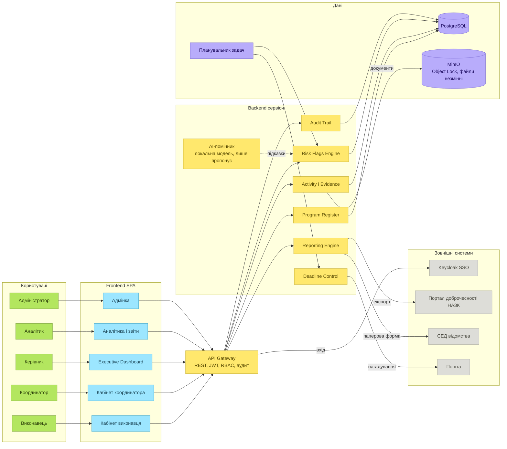

## Життєвий цикл заходу

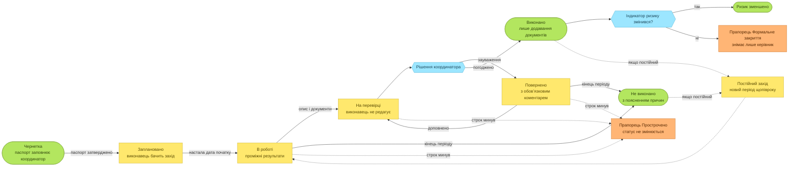

## Повний цикл роботи із заходом

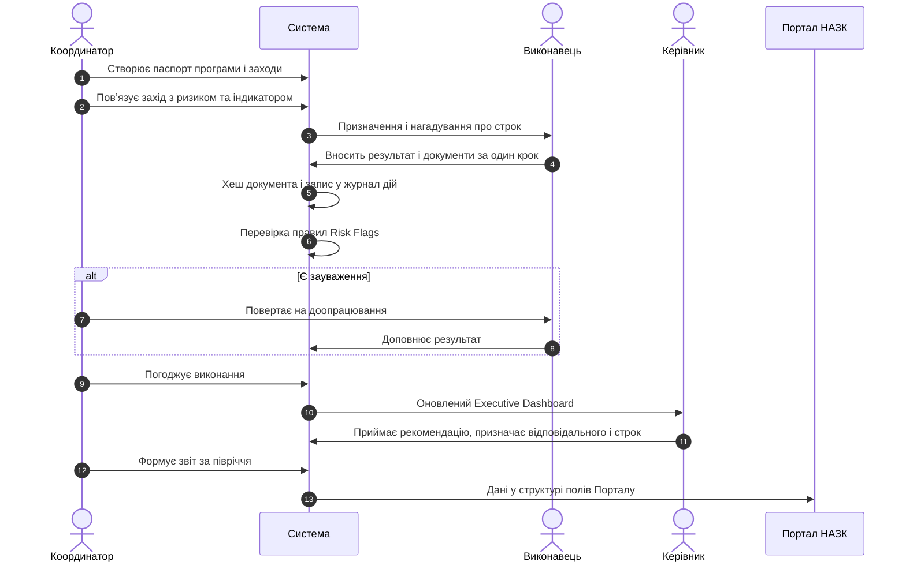

## Правила Risk Flags

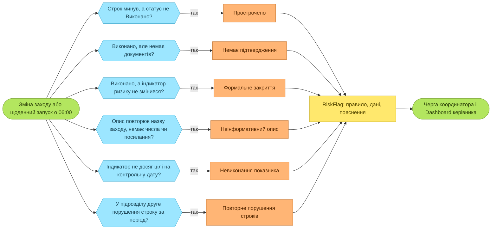

## Звіт за півріччя для Порталу НАЗК

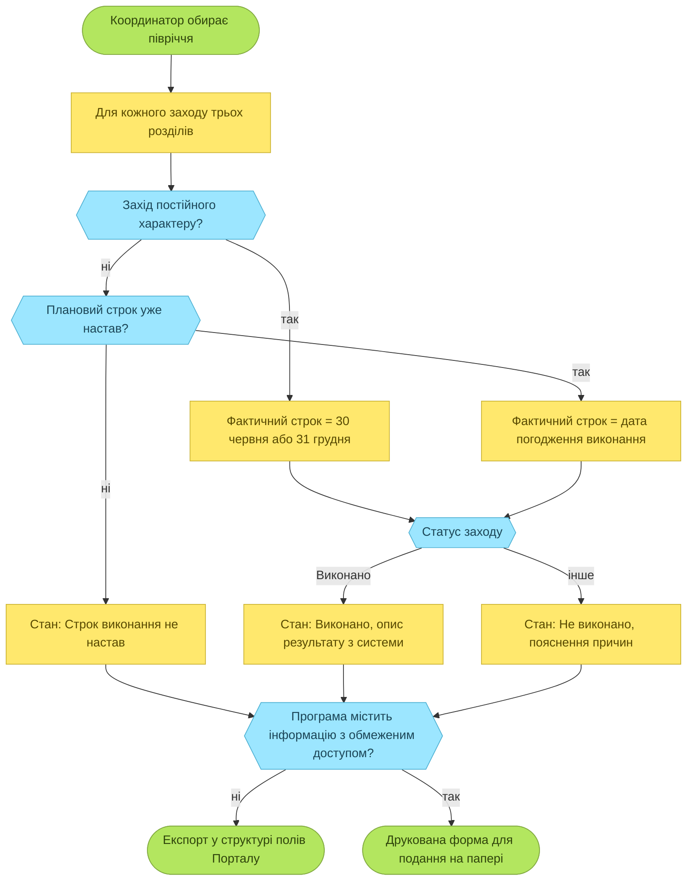

---

# 2. Бекенд

## Діаграма класів (доменна модель)

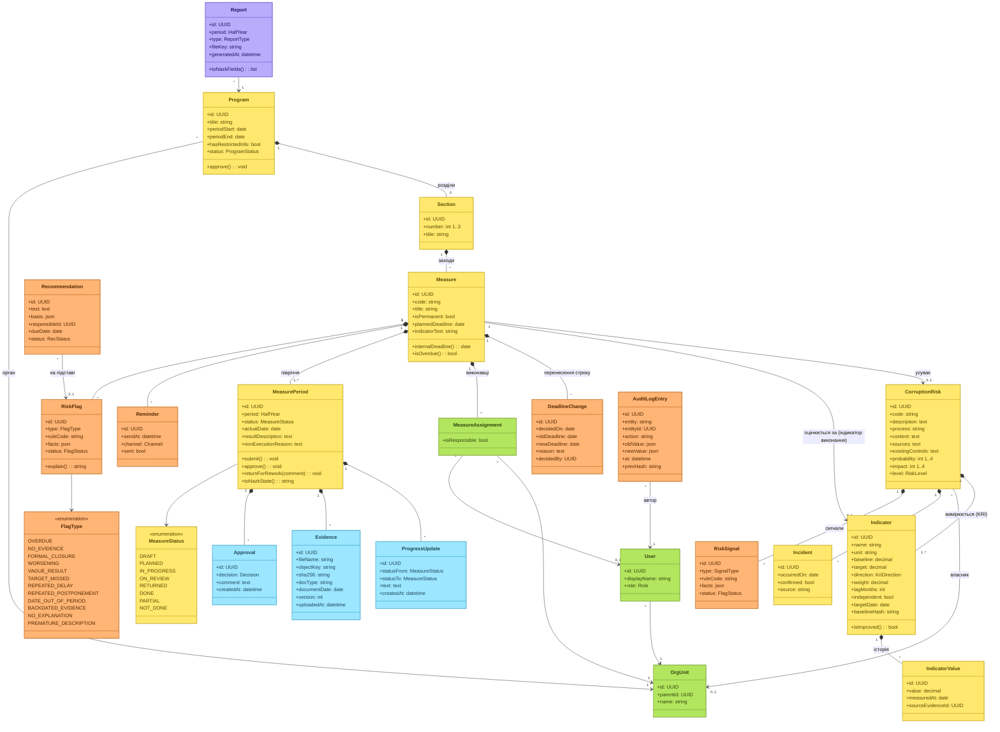

## Схема БД (PostgreSQL)

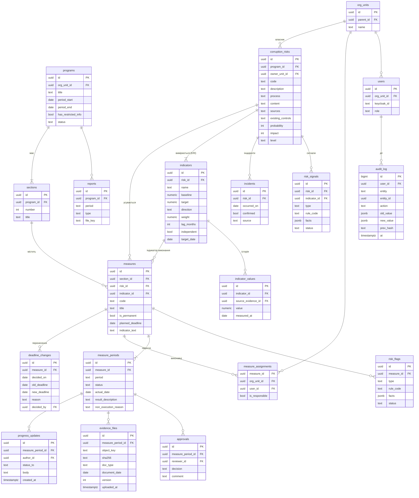

## REST API за модулями

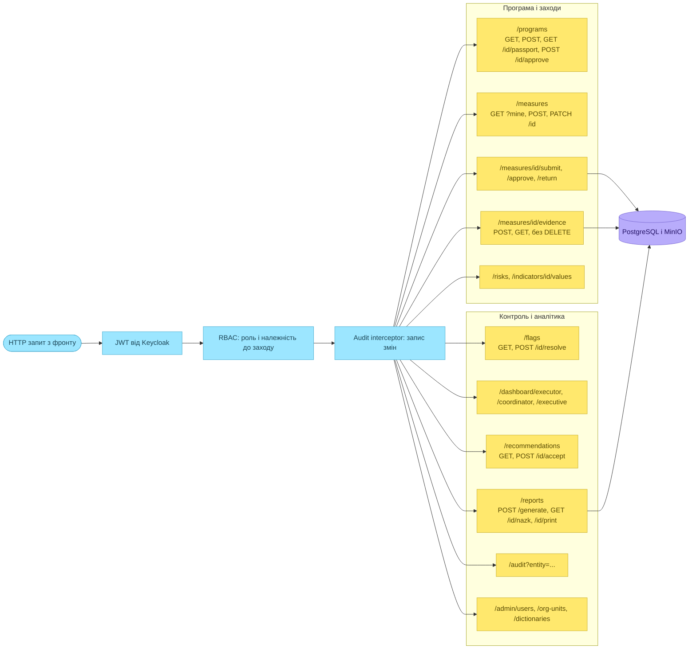

## Внесення результату виконавцем: що робить бекенд

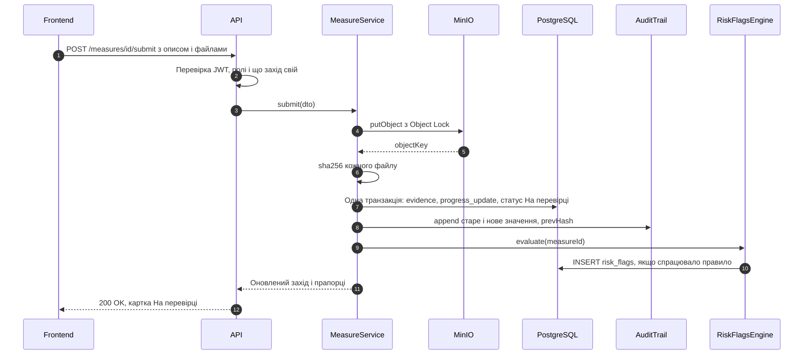

---

# 3. Фронтенд

## Роутинг і доступ за ролями

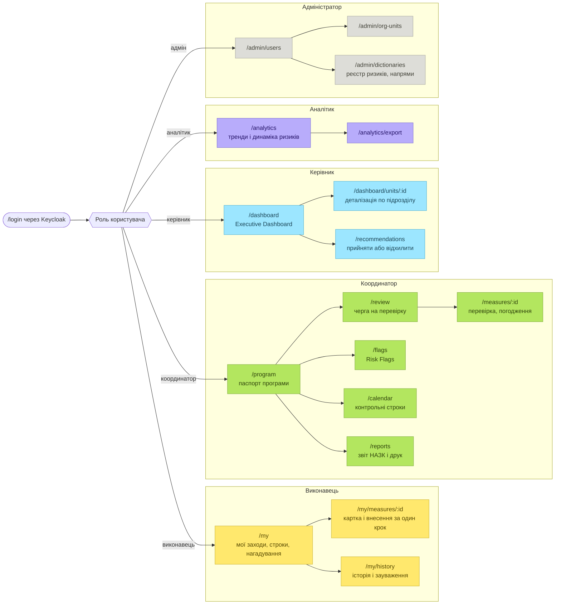

## Структура компонентів

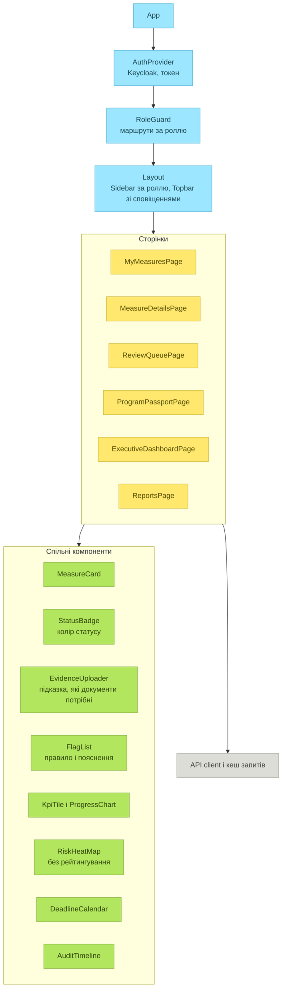

## Юзер-флоу виконавця: внесення за один крок

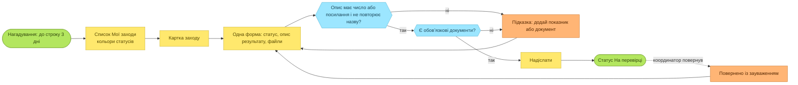

## Що на якому дашборді

```mermaid
flowchart TD
classDef exec fill:#FFE86D,stroke:#CBB333,color:#574900
classDef coord fill:#B3E65F,stroke:#84AC43,color:#2F440B
classDef head fill:#9CE6FF,stroke:#4FB1D3,color:#1C4657
subgraph db_exec [Кабінет виконавця]
x1[Мої заходи на найближчі 30 днів]:::exec
x2[Повернені із зауваженнями]:::exec
x3[Прострочені]:::exec
end
subgraph db_coord [Панель координатора]
y1[Черга на перевірку]:::coord
y2[Risk Flags за типами]:::coord
y3[Прогрес за трьома розділами]:::coord
y4[Календар контрольних строків]:::coord
y5[Готовність звіту за півріччя]:::coord
end
subgraph db_head [Executive Dashboard]
z1[Загальний стан програми]:::head
z2[Критичні заходи]:::head
z3[Стан корупційних ризиків: до і після]:::head
z4[Карта ризику невиконання за підрозділами]:::head
z5[Найближчі контрольні строки]:::head
z6[Рекомендації на рішення]:::head
end
src[(Одні й ті самі дані заходів)]
src --> x1
src --> y1
src --> z1
```

---
